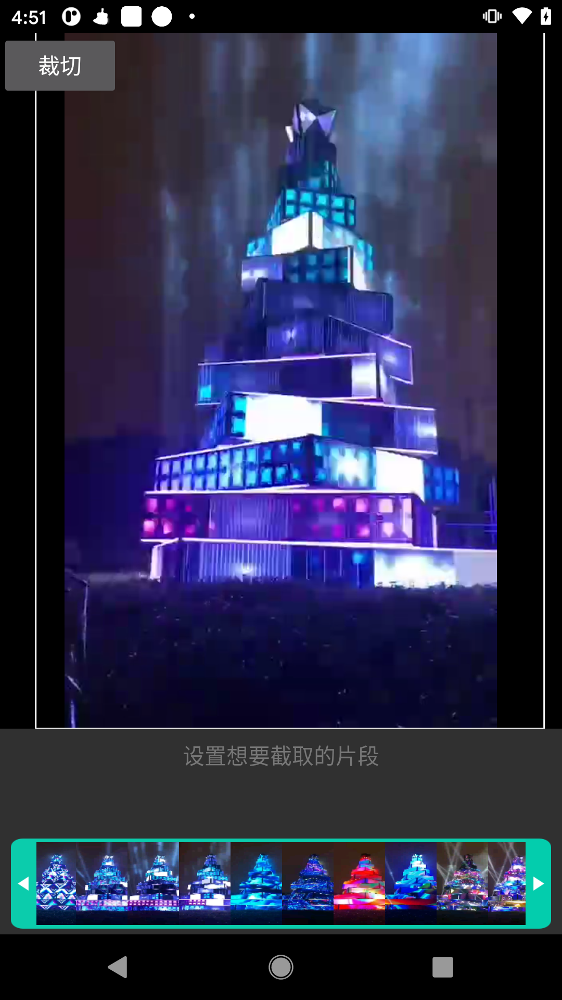

# VideoCrop

  <b>🌟 如果觉得有帮助，请点击 <a href="https://github.com/Pangu-Immortal/VideoCropping/stargazers">Star</a> 支持一下，关注不迷路！🌟</b>

A video crop demo base by ffmpeg

***

***

### ffmpeg比较大，可以考虑放到后台动态加载；

### 适配环境（Android 4.1 -- Android 12）

完整全工程代码。可以拉取代码直接运行。

***

---

## Star History

## Contributing

Contributions are welcome! Please feel free to submit a Pull Request.

1. Fork the repository
2. Create your feature branch (`git checkout -b feature/AmazingFeature`)
3. Commit your changes (`git commit -m 'Add some AmazingFeature'`)
4. Push to the branch (`git push origin feature/AmazingFeature`)
5. Open a Pull Request
## License

This project is licensed under the MIT License - see the [LICENSE](LICENSE) file for details.

---

## 联系与交流

  
  
  
  
  

<table align="center">
  <tr>
    <td align="center"><b>微信公众号</b>  扫码关注 · 案例复盘与方法论</td>
    <td align="center"><b>Star 趋势</b> </td>
  </tr>
</table>

**更多入口**：[GitHub 主页](https://github.com/Pangu-Immortal) · [Telegram 群](https://t.me/+MH0wU421vyQwYzBl) · [官网](https://mengqihome.cn)

## 许可

本项目采用 [PolyForm Noncommercial License 1.0.0](https://polyformproject.org/licenses/noncommercial/1.0.0) 授权：**允许非商业目的的使用、修改与分发；禁止任何商业性使用**。商业授权请联系 [hello@mengqihome.cn](mailto:hello@mengqihome.cn)。

<!-- managed-block:v1 -->
